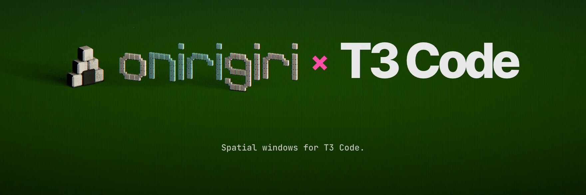

<p align="center">
  
</p>

# Onirigiri for T3 Code (Alpha)

An unofficial fork of [T3 Code](https://github.com/pingdotgg/t3code) that replaces the chat area
with an [Onirigiri](https://github.com/riteofstring/onirigiri) spatial workspace. Every
conversation, terminal, browser, file view and diff is a pane on a niri-style canvas: arrange panes
in rows and columns, pan across them and zoom out to an overview. T3 Code's sidebar, settings and
providers are unchanged.

This is an alpha. It is not made, endorsed or supported by the T3 Code team.

## Install

You do not need to build anything. Every
[release](https://github.com/riteofstring/t3code-onirigiri/releases) carries a ready-made installer
for each platform under **Assets**. Take the newest release.

Before you install, quit T3 Code if it is running. This app reads and writes the same `~/.t3` data
as T3 Code, so keep a copy of that folder.

### macOS (Apple silicon)

1. Download the `.dmg` file and open it.
2. Drag "Onirigiri for T3 Code (Alpha)" onto the Applications folder.
3. Open the app from Applications. macOS says it could not verify the app and does not open it.
   Close that message.
4. Open **System Settings → Privacy & Security**, scroll down to the note about the app and choose
   **Open Anyway**. You do this once; after that the app opens like any other.

There is no installer for Intel Macs.

### Windows (x64)

1. Download the `.exe` file and run it.
2. Windows shows "Windows protected your PC". Choose **More info**, then **Run anyway**.
3. The installer finishes by itself and starts the app.

The installer uses T3 Code's installer identity and install folder, so it replaces an installed
T3 Code. Where Smart App Control is on, Windows blocks the installer and offers no way to run it.

### Linux (x64)

1. Download the `.AppImage` file.
2. In a terminal, in the folder you downloaded it to, make the file executable and start it:

   ```bash
   chmod +x ./Onirigiri-*.AppImage
   ./Onirigiri-*.AppImage
   ```

### After installing

The installers are unsigned, which is why macOS and Windows ask before the first launch. The app
is named "Onirigiri for T3 Code (Alpha)"; its own windows and menus still say "T3 Code (Beta)".

Like T3 Code, it drives the coding agents already installed and signed in on your machine. See
[Install and first run](docs/user/install.md) for the providers and how to set them up.

Unlike T3 Code, this fork sends no product usage data unless you set
`T3CODE_TELEMETRY_ENABLED=true`. [Product usage data](docs/user/telemetry.md) lists what T3 Code
sends.

To build from source or run it in a browser, see the [Onirigiri guide](docs/onirigiri/README.md).

## Using the workspace

The controls at the bottom right switch between the two-dimensional layout and a single strip, open
the overview, show the minimap and set row height and column width. On macOS use Option for the
shortcuts below; elsewhere use Alt.

| Keys                      | Action                                                     |
| ------------------------- | ---------------------------------------------------------- |
| Option + arrows           | Move between panes                                         |
| Shift + Option + arrows   | Move between panes while typing                            |
| Option + Control + arrows | Move the focused pane                                      |
| Option + O                | Overview                                                   |
| Option + N                | New pane                                                   |
| Enter                     | Leave the overview at the selection, or fill an empty cell |

The [Onirigiri guide](docs/onirigiri/README.md#using-the-workspace) covers the rest.

## Known limits

- Shortly after a move, about one key press in ten takes more than 100 ms to appear, and up to
  about 0.4 s, while a chat is pictured or a neighbour loads in the background.
- Terminal and file panes drop keys typed before their text field takes focus on arrival.
- Leaving a maximized pane measured slower in this build than in the one before it; the cause is
  not yet traced.
- With the processor slowed four times, about one move in twenty has a frame gap of about a second
  as it comes to rest.
- Only chats have pictures. Other panes stay live while moving and in the overview.
- 4K displays and graphics memory use are untested.
- The Windows build leaves out the runtime T3 Code installs into a WSL distro, so running agents
  in WSL is untested and may not work.
- The app does not update itself. Download newer builds from Releases.
- The fork follows T3 Code's `main` as of 7 November 2026.

## Reporting problems

Report problems with this fork in
[its own issues](https://github.com/riteofstring/t3code-onirigiri/issues), not in T3 Code's issue
tracker, Discussions or Discord.

## T3 Code

Everything outside the workspace is T3 Code, and its [documentation](docs/) applies unchanged. For
the standard app, its installers and its community, go to
[pingdotgg/t3code](https://github.com/pingdotgg/t3code).

The repository keeps T3 Code's [MIT license](LICENSE). The Onirigiri engine is licensed under
Apache 2.0.
